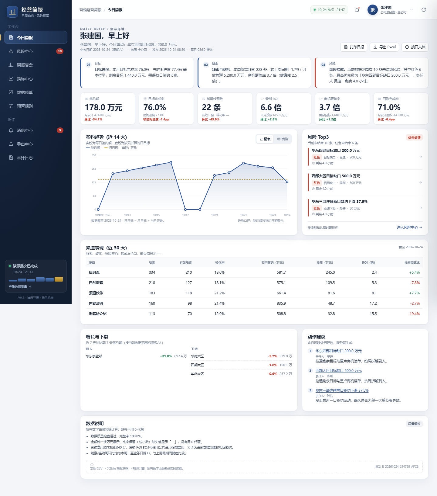

# 营销日周动态汇总与风险预警

> 把分散的销售数据，变成每天能看、有人管、能关闭的经营简报。



这是一个面向销售管理者的 PC 网页演示系统：每天从演示源数据计算经营指标，自动识别 6 类销售风险，生成日报和周报，并支持风险认领、转派、关闭和审计。

当前版本是 **MVP V0.1**（最小可行产品：先做能跑通核心流程的最小版本），已通过第三道独立验收关（Gate C，演示/试点范围）。**它不是生产系统，也没有接入真实 CRM/ERP。**

## 一、它解决什么问题

| 现在的痛点 | 这一版的做法 |
|---|---|
| 日报靠人拼，口径不一致 | 一屏看清目标、签约、回款、线索、商机覆盖和营销投入产出比 |
| 风险发现晚，等周会已经来不及 | 6 类风险自动触发，带证据、责任人、处理时限 |
| 口头答应，没人跟踪 | 待认领 → 处理中 → 已关闭/误报/长期跟踪，全程留痕，超时自动升级 |

## 二、这一版能做什么

- **4 类角色**：公司总经理、销售总监、事业部总经理、部门销售经理，各看各的范围。
- **12 项指标**：目标、签约、回款、线索、商机、客单价、转化率、营销投入产出比等。
- **6 类风险**：目标缺口、业绩下滑、线索异常、商机覆盖不足、大客户流失、订单/回款异常；红/橙/黄分级。
- **日/周简报**：日报计划 08:30 发布，周报周一 09:00 发布；支持导出 Excel、打印版和审计。
- **PC Web**：今日简报、风险中心、周报复盘、指标中心、数据质量、预警规则、消息、导出、审计。

演示数据固定为 **2026-10-24**，共 30 天，自然触发 10 条风险（红色 6、橙色 2、黄色 2）。

## 三、5 分钟跑起来

需要 Windows、Python 3.12 以上（本机用 Python 3.15 验证）。

```bat
cd MVP_V0.1
python -m venv .venv
.venv\Scripts\pip install -r requirements.txt
.venv\Scripts\python scripts\init_demo.py
start.bat
```

浏览器打开 <http://127.0.0.1:8000>，点账号卡片即可登录，不需要密码。

| 账号 | 姓名 | 角色 | 数据范围 |
|---|---|---|---|
| `u_gm` | 张建国 | 公司总经理 | 全公司 |
| `u_sd` | 李敏 | 销售总监 | 全公司销售条线 |
| `u_bu` | 王强 | 华东事业部总经理 | 本事业部及下级 |
| `u_sm` | 李娜 | 华东一部销售经理 | 本部门及本人 |

想恢复干净的演示数据：关闭服务窗口，双击 `MVP_V0.1\重置演示数据.bat`，再双击 `start.bat`。

## 四、仓库里有什么

| 目录/文件 | 内容 |
|---|---|
| `PRD一页纸_...` | 产品需求一页纸，V0.1 与 V0.2 简化版 |
| `竞品分析与开发方案...` | 竞品分析、自研/借鉴判断、系统架构与技术路线 |
| `开发规划_MVP_V0.1.md` | 开发、测试、验收三个独立关卡的规划 |
| `产品原型_V0.1/` | 可点击的 HTML 原型、用户流程图、桌面端/移动端线框图 |
| `内部演示_V0.1.pptx` | 6 页内部演示幻灯片，附 PDF 版 |
| `内部演示方案_V0.1.pdf` | 30 分钟演示流程、主持词、问答和应急方案 |
| `MVP交付说明_V0.1.pdf` | 交付范围、验收结果、已知问题和下一步建议 |
| `MVP_V0.1/` | 可运行的 FastAPI + SQLite MVP、页面、脚本、测试和验收证据 |

## 五、文档导航

### 产品与方案

- [PRD V0.1（Markdown）](PRD一页纸_营销日周动态汇总与风险预警_V0.1.md)
- [PRD V0.1（Word）](PRD一页纸_营销日周动态汇总与风险预警_V0.1.docx)
- [PRD V0.2 简化版（Word）](PRD一页纸_营销日周动态汇总与风险预警_V0.2_简化版.docx)
- [竞品分析与开发方案设计（PDF）](竞品分析与开发方案设计_营销日周动态汇总与风险预警_V0.1.pdf)
- [竞品分析与开发方案设计（Word）](竞品分析与开发方案设计_营销日周动态汇总与风险预警_V0.1.docx)
- [开发规划（Markdown）](开发规划_MVP_V0.1.md)

### 原型与设计

- [产品原型使用说明](产品原型_V0.1/使用说明.md)
- [可点击原型（HTML，下载后打开）](产品原型_V0.1/index.html)
- [用户流程图（PNG）](产品原型_V0.1/设计稿/用户流程图.png)
- [用户流程图（SVG）](产品原型_V0.1/设计稿/用户流程图.svg)
- [桌面端线框图（PNG）](产品原型_V0.1/设计稿/线框图_桌面端.png)
- [移动端线框图（PNG，早期探索稿）](产品原型_V0.1/设计稿/线框图_移动端.png)

> 本期 MVP 明确只做 PC Web，移动端线框图仅保留为早期设计记录。

### 演示材料

- [内部演示幻灯片（PPTX）](内部演示_V0.1.pptx)
- [内部演示幻灯片（PDF）](内部演示_V0.1.pdf)
- [内部演示方案（PDF）](内部演示方案_V0.1.pdf)
- [演示主持稿 · 两页简版（PDF）](内部演示主持稿_V0.1_两页简版.pdf)

### 开发、测试与验收

- [MVP 运行说明](MVP_V0.1/README.md)
- [MVP 交付说明（PDF）](MVP交付说明_V0.1.pdf)
- [MVP 交付说明 · 两页简版（PDF）](MVP交付说明_V0.1_两页简版.pdf)
- [独立测试报告](MVP_V0.1/docs/测试报告.md)
- [独立验收报告](MVP_V0.1/docs/验收报告.md)
- [验收证据目录](MVP_V0.1/docs/验收证据/)
- [页面截图目录](MVP_V0.1/data/screens/)

## 六、范围与边界

- 不是生产系统：演示登录没有密码，SQLite 单机，本地 HTTP，没有高可用和备份。
- 不是真实数据接入：用 10 个 CSV、30 天、2,083 行演示数据模拟，不接 CRM/ERP/钉钉/企微。
- 不是手机端：只做电脑网页，不做 H5 和手机适配。
- 不是完整推送：只有站内消息，没有真实钉钉/企微/邮件推送。
- 不是完整规则库：本轮按 6 类、8 个独立触发条件交付，12 条规则放在下一版。
- 没有定时调度器：“08:30 发布”是计划时间，当前需要人工或 Windows 任务计划程序触发。

## 七、技术栈

- 后端：Python 3.15、FastAPI、Pydantic、SQLite、openpyxl
- 前端：原生 HTML/CSS/JavaScript，PC Web，无前端框架
- 测试：pytest、FastAPI TestClient、浏览器端自测脚本
- 演示登录：HMAC 签名 Cookie；不是生产认证

## 八、数据与安全说明

仓库中的客户、联系人、手机号、邮箱和金额全部是生成的演示数据，不对应真实个人或公司。手机号和邮箱在页面、接口、Excel 和打印页中均已打码。请勿把本仓库的演示认证、默认密钥或 SQLite 配置直接用于生产环境。

## 九、许可证

本仓库用于方案演示与评审，暂未声明开源许可证；如需复用代码或文档，请先与作者确认。
